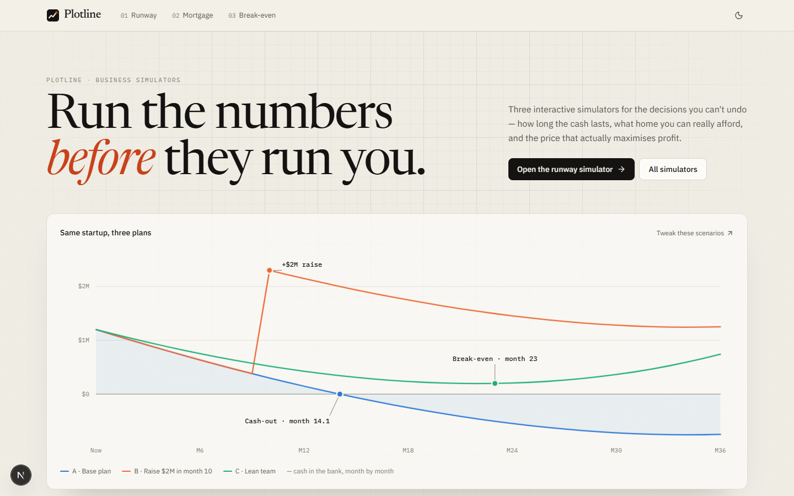
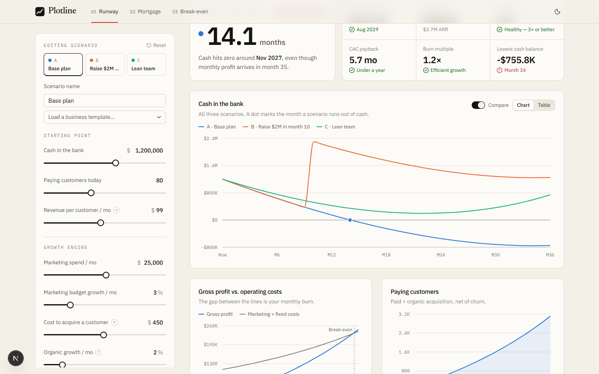
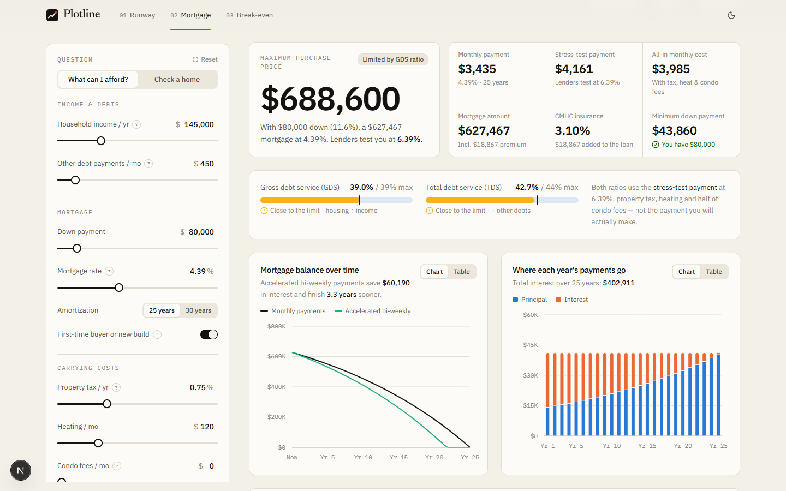
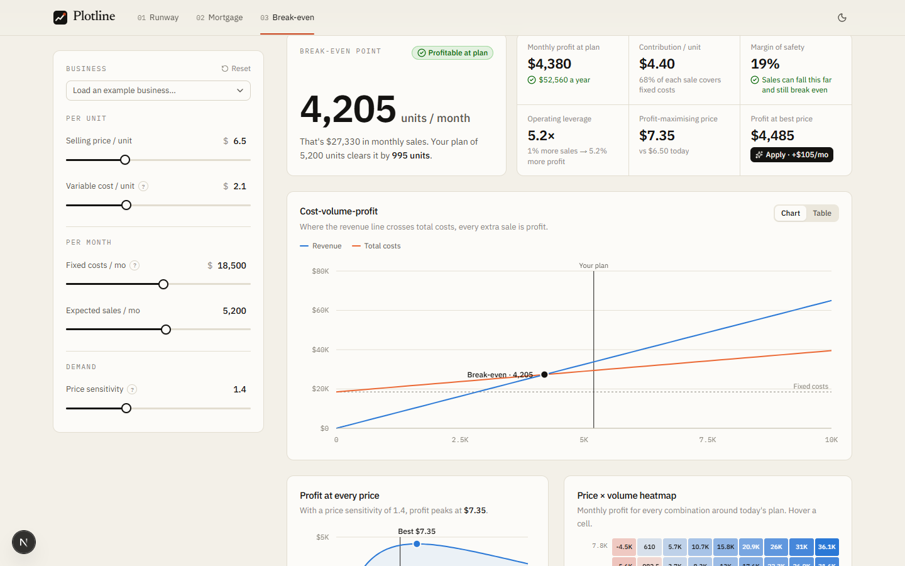
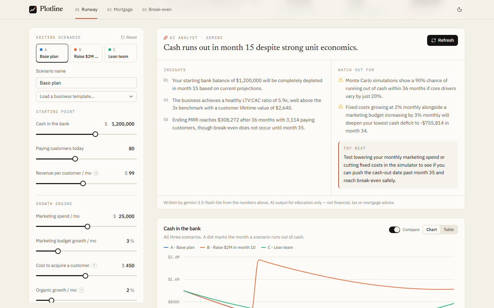

# Plotline — Business Simulators

**Run the numbers before they run you.** Three interactive simulators for the decisions you can't undo: how long a startup's cash lasts, what home you can really afford in Canada, and the price that actually maximises profit.

**Live demo:** _add your Vercel URL here_



## The simulators

### 01 · Cash runway & unit economics — `/runway`

- Three side-by-side scenarios (e.g. _base plan_, _raise $2M in month 10_, _lean team_), each fully editable, plus business templates
- Runway, cash-out date, break-even month, LTV:CAC, CAC payback, burn multiple, lowest cash balance
- **Monte Carlo stress test:** 1,000 seeded simulations with churn, CAC, organic growth and pricing drawn from log-normal distributions, plus month-to-month noise. Shows a P10–P90 fan chart, the probability of running out of cash, and a survival curve
- Scenario scorecard, monthly table view, CSV export



### 02 · Canadian mortgage affordability & stress test — `/mortgage`

- Maximum purchase price solved by binary search over the lender rules, or pass/fail for a specific home
- **Canadian rules encoded:** B-20 stress test (contract + 2% or 5.25%), GDS 39% / TDS 44%, tiered minimum down payment (5% / 10% / 20% at $1.5M), CMHC premiums by loan-to-value, 30-year amortization eligibility and surcharge, **semi-annual compounding**
- Amortization (monthly vs accelerated bi-weekly), yearly principal/interest split, and **renewal shock** — the new payment after a 5-year term if rates move



### 03 · Break-even & price optimizer — `/break-even`

- Break-even units and revenue, contribution margin, margin of safety, operating leverage
- Profit-maximising price from a constant-elasticity demand curve (Lerner rule), with one-click "apply best price"
- Cost-volume-profit chart, profit-vs-price curve and a diverging **price × volume heatmap**



## Everywhere

- **Every view is a link** — inputs are compressed into the URL (`lz-string`), so a scenario can be shared in one click
- **Exports** — CSV downloads and a print stylesheet for clean PDF reports
- **Accessible charts** — colour-blind-validated palette, a table view behind every chart, keyboard-friendly controls, `prefers-reduced-motion` respected
- **Light & dark themes**, responsive down to phone width
- Log-scale sliders so $10 → $100 gets the same travel as $10k → $100k; every value is also directly editable
- **AI analyst (optional)** — one click asks **Google Gemini** for three insights, two risks and a next move. The server re-runs the engine and briefs the model with its own numbers, so nothing the client sends can be "explained"; rate-limited per visitor; hidden when no key is configured



## Architecture

```
src/
├─ lib/sim/            ← pure TypeScript engines (no React) + Vitest tests
│  ├─ runway.ts           projection, KPIs, Monte Carlo
│  ├─ mortgage.ts         Canadian qualification rules, amortization, renewal
│  ├─ break-even.ts       CVP, elasticity pricing, profit grid
│  ├─ random.ts           seeded PRNG (mulberry32), log-normal shocks, percentiles
│  └─ fields.ts           input specs + sanitising untrusted URL state
├─ lib/ai/             ← AI analyst: engine → plain-text briefing (facts.ts), Gemini REST call + validation (gemini.ts)
├─ components/
│  ├─ sim/             ← shared UI: slider fields, stat tiles, chart frames, tables
│  ├─ charts/          ← Recharts theme, tooltips
│  ├─ runway/ mortgage/ break-even/   ← one client component per simulator
│  └─ home/            ← server-rendered SVG charts for the landing page
└─ app/                ← Next.js App Router pages, OG image, icon, /api/explain route
```

The engines are framework-free, so the same code powers the interactive charts, the CSV exports, the landing-page artwork (rendered on the server at build time) and the social card. Every page is statically prerendered.

## Tech stack

Next.js 16 (App Router, Turbopack) · React 19 · TypeScript · Tailwind CSS 4 · shadcn/ui + Radix · Recharts · Gemini API · Vitest · GitHub Actions · Vercel

## Run it locally

```bash
pnpm install
pnpm dev          # http://localhost:3000
pnpm test         # 41 unit tests on the engines
pnpm check        # lint + type-check + tests
pnpm build
```

Copy `.env.example` to `.env.local` to set the site URL and (optionally) an author name and repository link shown in the header and footer. Add a `GEMINI_API_KEY` (free from [Google AI Studio](https://aistudio.google.com)) to switch on the AI analyst; `GEMINI_MODEL` defaults to `gemini-3.5-flash-lite`.

## Deploy

Import the repository on [Vercel](https://vercel.com/new) — no configuration is needed (set `GEMINI_API_KEY` in the project's environment variables to enable the AI analyst). CI (`.github/workflows/ci.yml`) runs lint, type-check, tests with coverage and a production build on every push and pull request.

## Disclaimer

Educational estimates only — not financial, tax or mortgage advice. Canadian mortgage rules reflect federal policy as of December 15, 2024; lenders may apply stricter criteria.

## License

MIT
